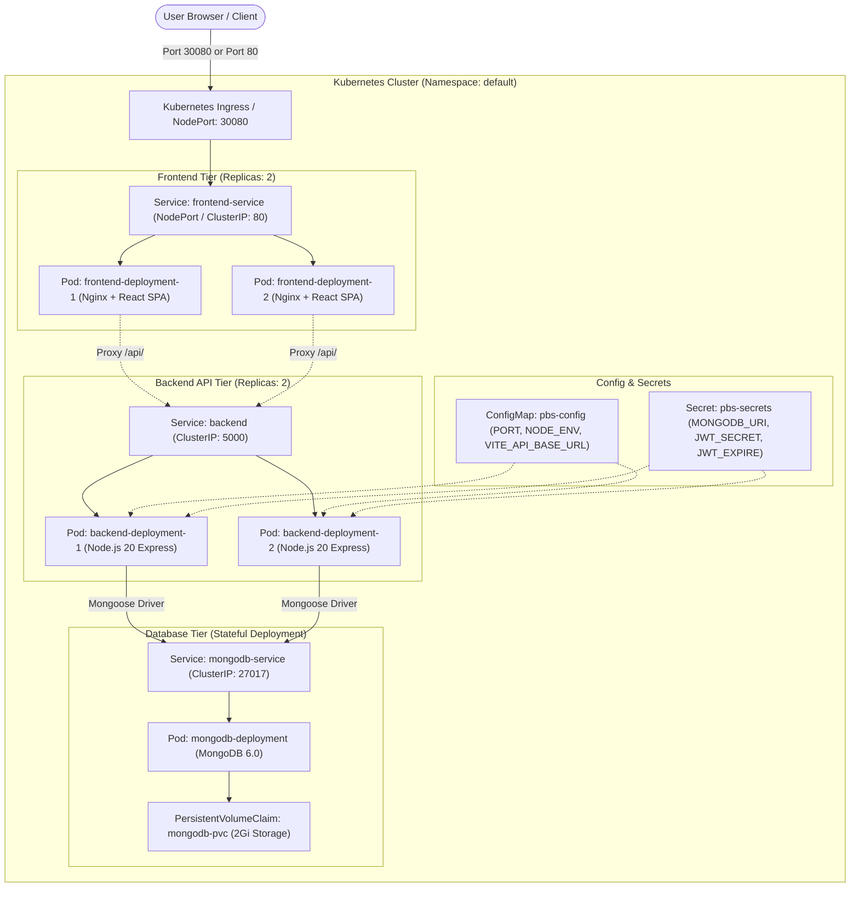

# PBS-RMS Docker & Kubernetes Deployment Guide

**Project:** Public Bicycle Sharing and Rental Management System (PBS-RMS)  
**Developer:** SUJAL REDDY  
**Hall Ticket Number:** 2303A51713  
**Subject:** DevOps & Full Stack  
**Academic Year:** 2026–2027  

---

## 1. DevOps Architecture Overview

The Public Bicycle Sharing and Rental Management System is containerized into a multi-tier microservices architecture and deployed on Kubernetes with high availability, self-healing, declarative scaling, and persistent storage.



---

## 2. Container Images & Docker Hub Registry

| Image Name | Base Image | Purpose | Docker Hub Target |
| :--- | :--- | :--- | :--- |
| **Backend API** | `node:20-alpine` | REST API, JWT auth, business logic, health probes | `sujalreddy/pbs-backend:latest` |
| **Frontend UI** | `nginx:alpine` (multi-stage) | React SPA bundle, Nginx reverse proxy for `/api/` | `sujalreddy/pbs-frontend:latest` |
| **Database** | `mongo:6.0` | Production NoSQL document storage with PVC | Official `mongo:6.0` |

---

## 3. Automated Docker Build & Push

### Option A: Windows Automated Script (One-Click)
Run the automated batch script in PowerShell or Command Prompt:
```cmd
cd "c:\public bicycle sharing system"
.\docker-build-push.bat sujalreddy latest
```
*(If no arguments are provided, it interactively prompts for your Docker Hub username.)*

### Option B: Linux / macOS / WSL Script
```bash
cd "c:/public bicycle sharing system"
chmod +x ./docker-build-push.sh
./docker-build-push.sh sujalreddy latest
```

### Option C: Manual CLI Commands
```bash
# 1. Authenticate with Docker Hub
docker login

# 2. Build Backend Docker Image
docker build -t sujalreddy/pbs-backend:latest -t sujalreddy/pbs-backend:v1.0.0 ./backend

# 3. Build Frontend Docker Image (Multi-Stage Build)
docker build -t sujalreddy/pbs-frontend:latest -t sujalreddy/pbs-frontend:v1.0.0 ./frontend

# 4. Push Images to Docker Hub
docker push sujalreddy/pbs-backend:latest
docker push sujalreddy/pbs-backend:v1.0.0
docker push sujalreddy/pbs-frontend:latest
docker push sujalreddy/pbs-frontend:v1.0.0
```

---

## 4. Kubernetes Deployment

The project provides modular manifests in `k8s/` as well as a single-command unified manifest `k8s/pbs-complete.yaml`.

### Manifest Hierarchy

```
k8s/
├── configmap.yaml             # Port, Environment, and Base URL configuration
├── secret.yaml                # Encrypted MONGODB_URI, JWT_SECRET, JWT_EXPIRE
├── mongodb-pvc.yaml           # 2Gi persistent disk claim
├── mongodb-service.yaml       # ClusterIP services (mongodb & mongodb-service)
├── mongodb-deployment.yaml    # 1 replica MongoDB 6.0 with liveness/readiness probes
├── backend-service.yaml       # ClusterIP services (backend & backend-service: 5000)
├── backend-deployment.yaml    # 2 replicas Node.js Express API with health probes
├── frontend-service.yaml      # NodePort service on port 30080 & ClusterIP port 80
├── frontend-deployment.yaml   # 2 replicas React Nginx client with SPA routing
├── ingress.yaml               # Path-based routing for Nginx Ingress Controller
├── kustomization.yaml         # Kustomize specification
└── pbs-complete.yaml          # All-in-one consolidated deployment manifest
```

---

## 5. Deployment Execution

### Step 1: Automated Deployment Script
On Windows:
```cmd
cd "c:\public bicycle sharing system"
.\k8s-deploy.bat
```

On Linux / macOS / WSL:
```bash
chmod +x ./k8s-deploy.sh
./k8s-deploy.sh
```

### Step 2: Or Direct `kubectl` Command
Deploy everything in the recommended dependency order:
```bash
kubectl apply -f k8s/pbs-complete.yaml
```
*Or using Kustomize:*
```bash
kubectl apply -k k8s/
```

### Step 3: Monitor Pod Rollout
```bash
# Watch deployment rollout status
kubectl rollout status deployment/mongodb-deployment
kubectl rollout status deployment/backend-deployment
kubectl rollout status deployment/frontend-deployment

# Verify running pods
kubectl get pods -l "app=pbs" -o wide

# Verify created services
kubectl get svc -l "app=pbs"
```

Expected output:
```
NAME                                   READY   STATUS    RESTARTS   AGE
backend-deployment-647d7c6778-4r8q9    1/1     Running   0          45s
backend-deployment-647d7c6778-q7z9k    1/1     Running   0          45s
frontend-deployment-788bfd7df4-3k2lm   1/1     Running   0          30s
frontend-deployment-788bfd7df4-x89w1   1/1     Running   0          30s
mongodb-deployment-55bdc87566-p8z2n    1/1     Running   0          60s
```

---

## 6. Accessing the Application

### Method 1: NodePort Service (Direct Local Access)
Because `frontend-service` exposes NodePort `30080`:
- **URL:** [http://localhost:30080](http://localhost:30080)
- In **Minikube**, retrieve the URL by running:
  ```bash
  minikube service frontend-service
  ```

### Method 2: Port Forwarding (Recommended for quick testing)
```bash
# Forward Frontend UI to local port 8080:
kubectl port-forward svc/frontend-service 8080:80

# Access in browser:
http://localhost:8080
```

To inspect Backend API directly:
```bash
kubectl port-forward svc/backend 5000:5000
curl http://localhost:5000/api/health
```

---

## 7. Auto-Seeding & Demo Credentials

When the Backend deployment connects to the fresh MongoDB instance, it automatically seeds 26 bicycles, 5 stations, 4 membership plans, and test accounts for all four user roles:

| Role | Email | Password | Pre-configured Access |
| :--- | :--- | :--- | :--- |
| **ADMIN** | `admin@pbs.com` | `admin123` | Full system access, fleet/station CRUD, reports |
| **OPERATIONS MANAGER** | `ops@pbs.com` | `ops123` | Availability monitoring, maintenance dispatch |
| **STATION ATTENDANT** | `attendant1@pbs.com` | `attendant123` | Metro Central station checkout/returns |
| **MEMBER** | `rahul@gmail.com` | `member123` | Bicycle reservation, active rental, passes |

---

## 8. Teardown & Cleanup

To gracefully tear down the cluster resources:
```cmd
# Windows:
.\k8s-teardown.bat

# Linux / Mac / WSL:
./k8s-teardown.sh

# Or manual kubectl:
kubectl delete -f k8s/pbs-complete.yaml
```

---

## 9. DevOps Best Practices Implemented

1. **Self-Healing Probes:**
   - Backend exposes `/api/health` checked by liveness and readiness HTTP probes.
   - MongoDB uses `mongosh --eval "db.adminCommand('ping')"` health checks.
   - Frontend uses Nginx index probes.
2. **Resource Requests & Limits:**
   - Every container defines precise CPU and memory requests and limits to prevent noisy neighbor issues.
3. **Multi-Stage Docker Builds:**
   - Frontend build uses Node.js for Vite compilation, then copies static assets to a tiny Nginx Alpine image, reducing final image footprint by over 80%.
4. **State Persistence:**
   - Database data is preserved across pod restarts using a `PersistentVolumeClaim` (2Gi).
5. **Decoupled Architecture:**
   - Nginx handles reverse proxying to `http://backend:5000/api/`, eliminating CORS issues in production.
