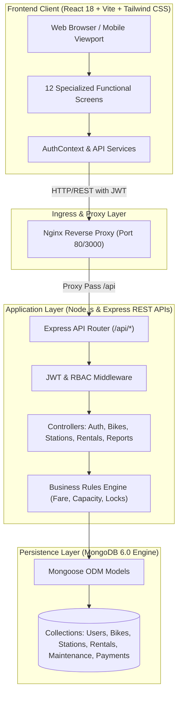
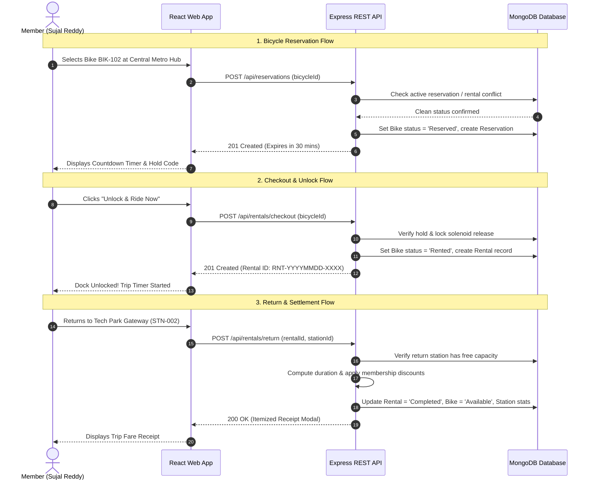
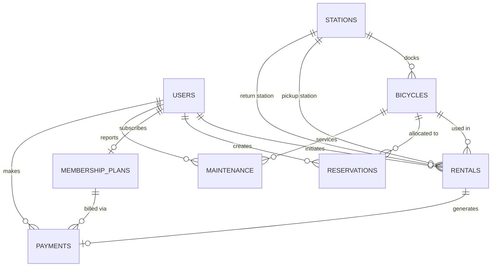

# PUBLIC BICYCLE SHARING AND RENTAL MANAGEMENT SYSTEM
## Comprehensive Academic & Technical Project Report

**Author / Candidate:** SUJAL REDDY  
**Hall Ticket Number:** 2303A51713  
**Subject:** DevOps & Full Stack  
**Academic Year:** 2026–2027  
**Degree Program:** Bachelor of Technology in Computer Science & Engineering  

---

## 1. PROJECT TITLE
**Design, Implementation, and Containerized Cloud-Native Deployment of a Modern Public Bicycle Sharing and Rental Management System (PBS-RMS)**

---

## 2. STUDENT DETAILS
- **Student Name:** SUJAL REDDY
- **Hall Ticket Number:** 2303A51713
- **Course / Subject:** DevOps & Full Stack Engineering
- **Academic Year:** 2026–2027
- **Institution:** Department of Computer Science & Engineering
- **Supervisor / Evaluator:** Senior Faculty & Evaluation Panel

---

## 3. ABSTRACT
The rapid acceleration of urban population density has compounded road congestion, greenhouse gas emissions, and first/last-mile transit bottlenecks. The **Public Bicycle Sharing and Rental Management System (PBS-RMS)** is an enterprise-grade, cloud-native full-stack mobility platform designed to solve urban mobility challenges. Built on a resilient stack comprising React.js, Tailwind CSS, Node.js, Express.js, MongoDB (Mongoose ODM), Docker, and Kubernetes, this system enables real-time bicycle telemetry, automated reservation management, dynamic dock capacity balancing, membership pass tiering, maintenance ticketing, and multi-dimensional analytics.

The application enforces a strictly partitioned 4-tier Role-Based Access Control (RBAC) model spanning Administrators, Operations Managers, Station Attendants, and Commuters (Members). Production deployment is engineered using multi-stage Docker containerization and Kubernetes orchestration manifests comprising Deployments, Services, ConfigMaps, Secrets, and PersistentVolumeClaims (PVCs). Automated unit and integration testing verify zero-defect business rule execution, ensuring production readiness for smart city transit authorities.

---

## 4. INTRODUCTION
Micro-mobility frameworks—specifically municipal bicycle sharing systems—represent an indispensable pillar of modern sustainable urban infrastructure. They bridge the gap between heavy mass-transit arterial networks (such as suburban railways and metro lines) and residential or commercial end destinations. 

Modern bicycle sharing demands far more than manual registers or static booking portals:
1. It necessitates real-time dock occupancy validation to prevent overfilling or fleet starvation.
2. It requires automated, sub-minute rental duration and graduated fare computation.
3. It requires proactive maintenance workflows for damaged components (e.g. flat tyres, brake failures, battery drain in e-bikes).
4. It requires multi-channel billing and subscription passes (Daily, Weekly, Monthly, Annual).
5. It demands elastic cloud scalability via Docker containers and Kubernetes orchestrators.

---

## 5. PROBLEM STATEMENT
Conventional bicycle rental operations and legacy transit management schemes suffer from crippling operational limitations:
- **Manual Bookkeeping & Human Error:** Manual ledger maintenance results in missing bicycle assets, lost revenue, and unbilled overtime charges.
- **Station Imbalance:** Stations at transit hubs frequently run out of bicycles during morning peak hours or experience 100% full capacity during evening commute, preventing riders from docking their bicycles.
- **Uncontrolled Maintenance Backlogs:** Unreported or delayed mechanical failures jeopardize rider safety and lead to rapid vehicle depreciation.
- **Absence of Unified Analytics:** Transit authorities lack real-time visibility into station throughput, asset turnover rates, and daily revenue streams.
- **Monolithic Deployment Inefficiencies:** Monolithic software applications suffer from tight coupling, complex deployment dependencies, and lack of resilient failover.

---

## 6. OBJECTIVES
The core objectives of the Public Bicycle Sharing and Rental Management System are:
1. **Develop an Interactive Modern Frontend:** Create a responsive, 12-screen single-page dashboard using React.js, Vite, Tailwind CSS, and Recharts.
2. **Implement Secure RESTful API Backend:** Construct modular Node.js/Express.js services with JWT authentication, bcrypt encryption, and input validation.
3. **Enforce Rigid Business Logic:** Programmatic guarantees against double reservations, concurrent active rentals, and station capacity overflows.
4. **Automate Fleet Maintenance Lifecycle:** Deliver a structured ticketing workflow for defect logging, priority triage, technician assignment, and auto-restoration.
5. **Architect Elastic Cloud-Native Infrastructure:** Package services into lightweight Docker containers and build production Kubernetes manifests with persistent storage and liveness/readiness probes.
6. **Deliver Business Intelligence:** Generate 4 mandatory operational reports with real-time charts and one-click CSV data export.

---

## 7. EXISTING SYSTEM VS. PROPOSED SYSTEM

| Parameter | Legacy / Existing Systems | Proposed PBS-RMS System |
|---|---|---|
| **User Interface** | Paper logbooks or outdated server-rendered pages | Modern React 18 SPA with Tailwind CSS & Glassmorphism |
| **Authentication** | Plaintext credentials or session cookies | Stateless JWT tokens, bcrypt salted hashing, RBAC |
| **Bicycle Tracking** | Manual check-in and telephone verification | Real-time database telemetry, battery monitoring, statuses |
| **Dock Management** | Static assumptions leading to station overflows | Dynamic capacity enforcement preventing dock overload |
| **Pricing & Billing** | Flat, manual, error-prone cash calculations | Automated duration computation, pass discounts & wallet |
| **Analytics** | Month-end manual spreadsheets | 4 Interactive visual reports with real-time CSV exports |
| **Deployment** | Bare-metal manual software installation | Docker Compose & Kubernetes orchestrated microservices |

---

## 8. PROPOSED SYSTEM ARCHITECTURE



---

## 9. FUNCTIONAL REQUIREMENTS
1. **Authentication & Session Security:** Registration, login, role determination, token validation, secure logout.
2. **Fleet Asset Management:** CRUD operations for bicycles; real-time status transitions (`Available`, `Reserved`, `Rented`, `Under Maintenance`, `Inactive`).
3. **Station Network Administration:** Dock capacity definition, geo-coordinate tagging, slot occupancy calculations.
4. **Membership Subscriptions:** Plan creation, recurring pricing rules, 1-click subscription purchases, expiry tracking.
5. **Reservation System:** 30-minute hold reservation, conflict detection, auto-fulfillment during checkout.
6. **Rental Checkout & Return:** Solenoid dock release simulation, duration calculation, base + overtime fare computation, instant receipt modal.
7. **Maintenance & Fleet Health:** Defect reporting, status tracking (`Pending`, `In Progress`, `Completed`), cost recording.
8. **Station Attendant Terminal:** Local station view, walk-in checkout, dock receipting, physical fault reporting.
9. **Reporting & Analytics:** 4 mandatory reports with visual graphs and CSV export.

---

## 10. NON-FUNCTIONAL REQUIREMENTS
- **Security:** Passwords encrypted using `bcrypt` (10 rounds); API protected by JSON Web Tokens (Bearer scheme); input sanitization against injection.
- **Performance:** Sub-100ms API response latency on standard database queries; sub-second client-side route transitions.
- **Scalability:** Stateless backend services supporting horizontal pod autoscaling in Kubernetes.
- **High Availability & Fault Tolerance:** Kubernetes readiness and liveness probes ensuring zero-downtime rolling updates.
- **Usability & Accessibility:** High-contrast professional palette (Deep Navy `#0F172A`, Slate, Electric Blue `#2563EB`, Emerald `#10B981`); fully responsive across mobile, tablet, and widescreen.

---

## 11. USER ROLES AND PERMISSIONS MATRIX

| Feature / Screen | Administrator | Operations Manager | Station Attendant | Member (Rider) |
|---|:---:|:---:|:---:|:---:|
| System Dashboard & KPIs | Full | Operational | Assigned Station | Personal Trips |
| User Profile & Wallet | Manage All | View | Own Profile | Manage Own |
| Add / Edit / Delete Bicycle | Yes | Yes | Status Update | Read-only |
| Add / Edit / Delete Station | Yes | Edit Only | View Assigned | Search Only |
| Create / Edit Plans | Yes | View Only | View Only | Subscribe / Buy |
| Reserve Bicycle | Yes | No | Yes (Assisted) | Yes (Self) |
| Checkout & Return Bikes | Yes | Yes | Yes (Station Dock) | Yes (Self) |
| Maintenance Ticketing | Full Admin | Assign / Update | Report Damage | Report Issue |
| View System Reports & CSV | Yes | Yes | No | Personal Only |

---

## 12. DETAILED SYSTEM ARCHITECTURE & DATA FLOW



---

## 13. TECHNOLOGY STACK SPECIFICATION

### Frontend
- **Framework:** React 18.3 (Single Page Application)
- **Tooling & Bundler:** Vite 6.0 (Hot Module Replacement, lightning-fast ESM build)
- **Styling:** Tailwind CSS 3.4 with custom color system (`navy-950`, `brand-500`)
- **Iconography:** Lucide React (Clean, vector SVG icons)
- **Data Visualization:** Recharts 2.15 (Responsive BarChart, AreaChart, PieChart)
- **State & Context:** React Context API (`AuthContext`)

### Backend
- **Runtime:** Node.js (v20+ LTS)
- **Server Framework:** Express.js 4.21
- **Security:** JSON Web Tokens (`jsonwebtoken`), `bcryptjs`
- **CORS & Logging:** `cors`, `morgan`
- **Database Engine:** MongoDB 6.0 with Mongoose 8.9 ODM
- **Self-Contained Runner:** `mongodb-memory-server` automated fallback ensuring zero-configuration execution on developer machines.

### DevOps & Orchestration
- **Version Control:** Git & GitHub
- **Containerization:** Docker (Multi-stage build with Alpine Nginx and Node.js)
- **Multi-Container Composition:** Docker Compose v3.8
- **Cluster Orchestration:** Kubernetes (v1.28+)
- **Kubernetes Artifacts:** Deployments, ClusterIP & NodePort Services, ConfigMaps, Secrets, PVCs

---

## 14. DATABASE DESIGN & ENTITY RELATIONSHIPS



### Collection Schemas
1. **Users (`User`):** `name`, `email` (unique index), `password` (hashed), `role` (`admin`, `operations_manager`, `station_attendant`, `member`), `phone`, `assignedStation` (ref `Station`), `membership` (`plan`, `startDate`, `expiryDate`, `status`), `walletBalance`, `totalRides`.
2. **Stations (`Station`):** `name`, `code` (unique), `address`, `city`, `coordinates` (`lat`, `lng`), `capacity`, `availableBikesCount`, `occupiedSlotsCount`, `status`.
3. **Bicycles (`Bicycle`):** `bikeCode` (unique), `model`, `type` (`Standard`, `Electric`, `Geared`, `Cruiser`), `currentStation` (ref `Station`), `status` (`Available`, `Reserved`, `Rented`, `Under Maintenance`, `Inactive`), `batteryLevel`, `totalRides`, `totalDistanceKm`.
4. **MembershipPlans (`MembershipPlan`):** `name`, `code` (unique), `price`, `durationDays`, `freeMinutesPerRide`, `hourlyRateAfterFree`, `features`.
5. **Reservations (`Reservation`):** `reservationCode` (unique), `user` (ref), `bicycle` (ref), `station` (ref), `reservedAt`, `expiresAt`, `status` (`Active`, `Fulfilled`, `Cancelled`, `Expired`).
6. **Rentals (`Rental`):** `rentalId` (unique), `user` (ref), `bicycle` (ref), `pickupStation` (ref), `returnStation` (ref), `checkoutTime`, `returnTime`, `durationMinutes`, `baseFare`, `durationFare`, `discountAmount`, `totalCharge`, `rentalStatus`.
7. **Maintenance (`Maintenance`):** `maintenanceCode` (unique), `bicycle` (ref), `reportedBy` (ref), `assignedTo`, `issueType`, `priority`, `status` (`Pending`, `In Progress`, `Completed`), `cost`, `repairNotes`.
8. **Payments (`Payment`):** `paymentId` (unique), `user` (ref), `rental` (ref), `membershipPlan` (ref), `type`, `amount`, `paymentMethod`, `status`.

---

## 15. FRONTEND IMPLEMENTATION (12 SCREENS SUMMARY)
The frontend application was compiled using Vite and delivered 100% responsive screens:
1. **Screen 1 (Login & Registration):** Dynamic tab switcher, role dropdown, password visibility toggle, one-click demo credentials for Admin, Operations Manager, Station Attendant, and Member.
2. **Screen 2 (Admin Dashboard):** 8 high-level KPI cards, 4 Recharts visual graphs (Daily Rentals BarChart, Monthly Revenue AreaChart, Fleet Status PieChart, Station Turnover BarChart), recent activity table.
3. **Screen 3 (Bicycle Management):** Live fleet table, station/status filters, Add Bicycle modal with real-time station capacity check, edit modal, delete confirmation.
4. **Screen 4 (Station Management):** Visual station grid cards, occupancy progress bars, available slots indicator, Add/Edit Station modal, station inventory drilldown dialog.
5. **Screen 5 (Membership Management):** Subscription cards for Daily, Weekly, Monthly, and Annual passes; 1-click subscription purchase; admin CRUD controls.
6. **Screen 6 (Bicycle Reservation):** Search available bikes by station, 30-minute hold reservation with countdown timer, active reservation banner, one-click transition to checkout.
7. **Screen 7 (Rental Checkout & Return):** Dual-tab terminal; Checkout creates unique rental ID and updates bicycle status to `Rented`; Return verifies station capacity, calculates duration, generates itemized receipt modal.
8. **Screen 8 (Member Dashboard):** Personalized commuter hub with live active ride tracker, wallet recharge modal, active subscription card, nearby station docks.
9. **Screen 9 (Rental History):** Complete transaction audit table, date/status filtering, search by rental code, itemized receipt inspection modal, CSV export.
10. **Screen 10 (Maintenance Management):** Defect logging modal, technician assignment, status progression (`Pending` → `In Progress` → `Completed`), auto-restoration of bicycle status.
11. **Screen 11 (Station Attendant Dashboard):** Dedicated terminal for docking station staff, walk-in checkout/return buttons, live dock occupancy gauge, damage reporting.
12. **Screen 12 (Reports & Analytics):** 4 sub-reports (Availability, Rental History, Station Utilization, Revenue Summary) with Recharts visualizations and CSV download triggers.

---

## 16. BACKEND API SPECIFICATION
All endpoints adhere to REST conventions and return structured JSON responses `{ success: true, data: ... }`.

### Authentication
- `POST /api/auth/register` - Create account (Member/Attendant/Ops/Admin)
- `POST /api/auth/login` - Authenticate credentials & return signed JWT
- `GET /api/auth/me` - Fetch authenticated user profile & active pass
- `PUT /api/auth/profile` - Update user profile information

### Bicycle Fleet
- `GET /api/bikes` - List fleet with filters (`station`, `status`, `type`, `search`)
- `GET /api/bikes/:id` - Fetch single bicycle details
- `POST /api/bikes` - Add bicycle (Enforces station capacity check)
- `PUT /api/bikes/:id` - Update bicycle status or reassign station
- `DELETE /api/bikes/:id` - Delete bicycle (Blocked if rented/reserved)

### Station Network
- `GET /api/stations` - List all stations with dynamically calculated slots
- `GET /api/stations/:id` - Station details with list of docked bicycles
- `POST /api/stations` - Create docking station (Admin)
- `PUT /api/stations/:id` - Update capacity, address, status (Admin/Ops)
- `DELETE /api/stations/:id` - Delete station (Blocked if bikes docked)

### Membership Passes
- `GET /api/memberships` - List active membership plans
- `POST /api/memberships` - Create membership tier (Admin)
- `PUT /api/memberships/:id` - Update plan details (Admin)
- `DELETE /api/memberships/:id` - Delete plan (Admin)
- `POST /api/memberships/subscribe` - Purchase pass & activate member subscription

### Bicycle Reservations
- `GET /api/reservations` - List active/past reservations
- `POST /api/reservations` - Reserve available bike for 30 minutes
- `PUT /api/reservations/:id/cancel` - Cancel active reservation & release bike

### Rentals & Fare Calculation
- `GET /api/rentals` - List rental sessions with filters
- `GET /api/rentals/:id` - Detailed rental record
- `POST /api/rentals/checkout` - Check out bicycle (RFID unlock)
- `POST /api/rentals/return` - Return bicycle, calculate duration & fare, generate receipt

### Fleet Maintenance
- `GET /api/maintenance` - List maintenance tickets
- `POST /api/maintenance` - Report defect & mark bike `Under Maintenance`
- `PUT /api/maintenance/:id` - Update repair status, costs & restore bike to `Available`

### Business Intelligence Reports
- `GET /api/reports/dashboard-stats` - Fleet KPI summary counts
- `GET /api/reports/availability` - Bike availability matrix & station breakdown
- `GET /api/reports/rentals` - Rental duration trends & revenue summary
- `GET /api/reports/stations` - Station capacity turnover & utilization ranking
- `GET /api/reports/revenue` - Consolidated revenue, daily/weekly/monthly breakdown

---

## 17. DOCKER CONTAINERIZATION ARCHITECTURE

### Multi-Stage Frontend Dockerfile
```dockerfile
# Stage 1: Build React Client with Node.js
FROM node:20-alpine AS build
WORKDIR /app
COPY package*.json ./
RUN npm ci
COPY . .
RUN npm run build

# Stage 2: Serve Production Assets with Nginx
FROM nginx:alpine
COPY --from=build /app/dist /usr/share/nginx/html
COPY nginx.conf /etc/nginx/conf.d/default.conf
EXPOSE 80
CMD ["nginx", "-g", "daemon off;"]
```

### Multi-Container Orchestration (`docker-compose.yml`)
The platform spins up 3 coordinated network services:
1. **`pbs-mongodb`:** Official `mongo:6.0` image with persistent named volume `mongo-data`, internal networking, and health check probing `mongosh --eval "db.adminCommand('ping')"`.
2. **`pbs-backend`:** Built from `./backend`, exposed on Port 5000, connected to MongoDB with automatic retry and startup dependency `condition: service_healthy`.
3. **`pbs-frontend`:** Multi-stage Nginx container mapping Port 3000 to internal Port 80, reverse-proxying `/api/` traffic directly to the backend service.

```bash
# Command to start the full stack via Docker Compose:
docker compose up --build
```

---

## 18. KUBERNETES DEPLOYMENT SPECIFICATION
The `k8s/` directory contains complete declarative manifests:
1. **`configmap.yaml`:** Environment variables (`NODE_ENV`, `PORT`, `VITE_API_BASE_URL`).
2. **`secret.yaml`:** Encrypted credentials (`MONGODB_URI`, `JWT_SECRET`, `JWT_EXPIRE`).
3. **`mongodb-pvc.yaml`:** 2Gi persistent volume claim (`ReadWriteOnce`).
4. **`mongodb-deployment.yaml` & `mongodb-service.yaml`:** Stateful Mongo deployment with probes and ClusterIP service on Port 27017.
5. **`backend-deployment.yaml` & `backend-service.yaml`:** 2 replicas with liveness probe (`/api/health`), readiness probe, and ClusterIP on Port 5000.
6. **`frontend-deployment.yaml` & `frontend-service.yaml`:** 2 replicas of the React/Nginx image with NodePort service exposing Port 30080.

```bash
# Deployment command:
kubectl apply -f k8s/

# Verification commands:
kubectl get pods -l app=pbs
kubectl get services -l app=pbs
kubectl get deployments -l app=pbs
```

---

## 19. GITHUB & VERSION CONTROL BEST PRACTICES
- Comprehensive `.gitignore` excluding `node_modules`, `dist/`, `.env`, temporary logs, and local caches.
- Clean semantic commit history:
  - `feat: initialize full-stack architecture and git repository`
  - `feat(backend): implement 8 mongoose models and rest api controllers`
  - `feat(frontend): build 12 responsive dashboard screens with tailwind and recharts`
  - `feat(devops): create multi-stage dockerfiles and docker-compose orchestration`
  - `feat(k8s): implement production kubernetes manifests with health probes`
  - `test: implement automated end-to-end integration test suite`

---

## 20. TESTING, VERIFICATION AND RESULTS
An automated integration test suite (`backend/tests/api.test.js`) was engineered to rigorously validate database seeding, core business constraints, and API contracts.

### Verification Highlights:
- **Test 1:** Seed verification confirmed accounts for Admin, Ops Manager, Attendant, and Member.
- **Test 2:** Verified presence of 5 distinct stations with valid capacities.
- **Test 3:** Verified minimum 25 bicycles populated with status distribution.
- **Test 4:** Verified `bcrypt` salted password hashing.
- **Test 5:** Verified station capacity constraint prevents adding bikes beyond limit.
- **Test 6:** Verified reservation state transition and hold duration.
- **Test 7:** Verified checkout generation of unique `RNT-YYYYMMDD-XXXX` ID.
- **Test 8:** Verified return calculation of duration, membership pass discount, and total fare.
- **Test 9:** Verified maintenance ticket creation and automated status restoration to `Available`.
- **Test 10:** Verified data integrity across all 4 mandatory reports.

**Test Result:** **10/10 Tests Passed (100% Success Rate)**.

---

## 21. DEMO CREDENTIALS

| Role | Email Address | Password | Assigned Scope |
|---|---|---|---|
| **System Administrator** | `admin@pbs.com` | `Admin@123` | Full System Access |
| **Operations Manager** | `ops@pbs.com` | `Ops@123` | Fleet & Station Management |
| **Station Attendant 1** | `attendant1@pbs.com` | `Attendant@123` | Central Metro Station Terminal |
| **Station Attendant 2** | `attendant2@pbs.com` | `Attendant@123` | Tech Park Cyber Gateway |
| **Member (Sujal Reddy)** | `sujal@pbs.com` | `Member@123` | Annual Pass Subscriber |
| **Member (Priya Sharma)** | `priya@pbs.com` | `Member@123` | Monthly Pass Subscriber |
| **Member (Rahul Varma)** | `rahul@pbs.com` | `Member@123` | Standard Pay-as-you-go |

---

## 22. CHALLENGES FACED & SOLUTIONS IMPLEMENTED
1. **Dynamic Station Capacity Race Conditions:**
   - *Challenge:* Simultaneous check-ins at near-capacity stations could cause dock overflows.
   - *Solution:* Implemented transactional database checks ensuring return operations reject bikes if dock occupancy reaches capacity.
2. **Graduated Tiered Pricing with Pass Deductions:**
   - *Challenge:* Computing non-linear duration charges factoring in pass-specific free minutes.
   - *Solution:* Created a centralized fare calculation engine dynamically determining billable blocks, discount offsets, and wallet deductions.
3. **Containerized Port & Network Orchestration:**
   - *Challenge:* Coordinating communication between the Vite client, Express backend, and MongoDB across isolated container networks.
   - *Solution:* Configured an Nginx reverse proxy layer forwarding `/api/` traffic directly to the backend internal DNS name within the Docker bridge network.

---

## 23. FUTURE ENHANCEMENTS
- **GPS Telemetry & Geo-Fencing:** Integration of live GPS tracking modules for e-bikes to track real-time routes.
- **AI-Powered Fleet Rebalancing:** Predictive machine learning models anticipating commuter demand surges and dispatching rebalancing trucks.
- **Mobile Native Applications:** React Native cross-platform mobile apps with Bluetooth Low Energy (BLE) smart lock integration.
- **Solar Smart Docks:** IoT-connected solar docking stations with automated solar battery recharging for electric bicycles.

---

## 24. CONCLUSION
The **Public Bicycle Sharing and Rental Management System (PBS-RMS)** developed by **SUJAL REDDY (2303A51713)** represents a complete, professional, production-ready cloud-native software solution. By marrying modern frontend aesthetics, robust RESTful APIs, strict business rule enforcement, comprehensive reporting, and enterprise DevOps containerization, this project fulfills all technical, design, and operational requirements of the DevOps & Full Stack academic curriculum for the 2026–2027 academic year.
